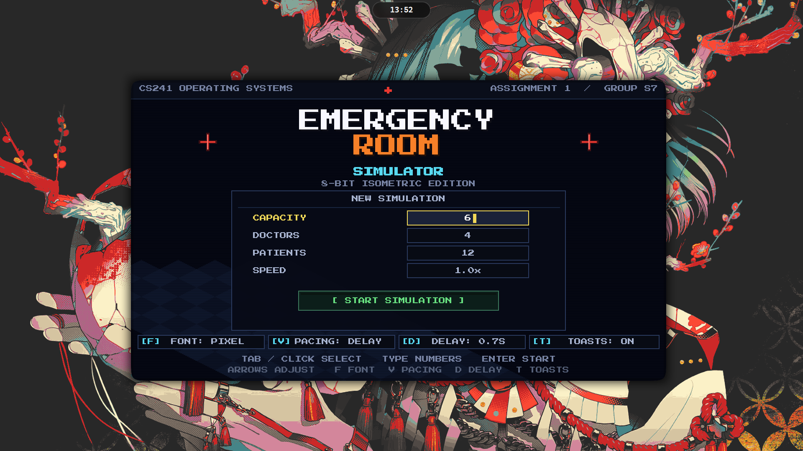
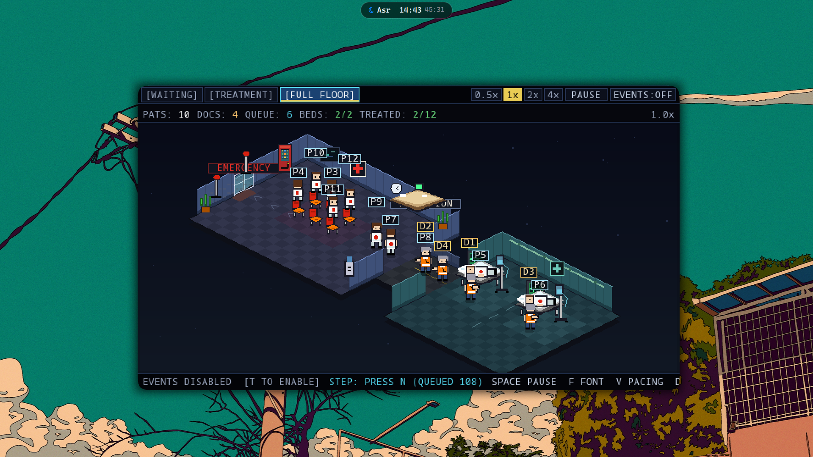
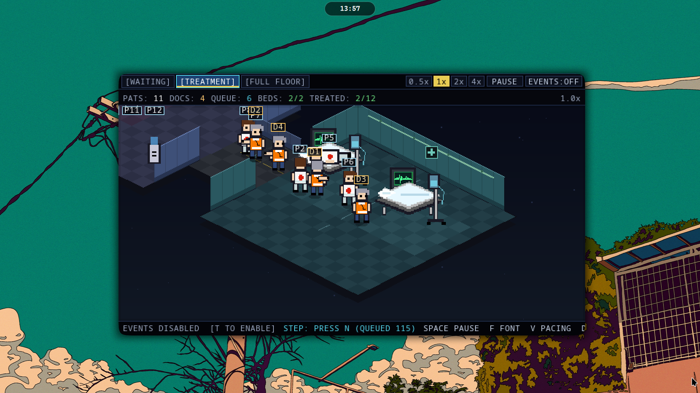
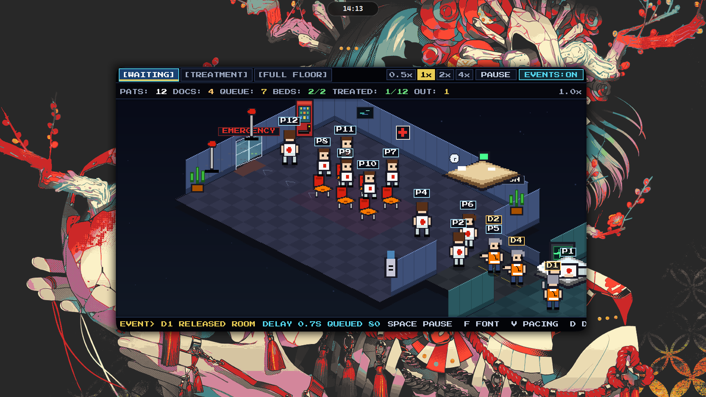
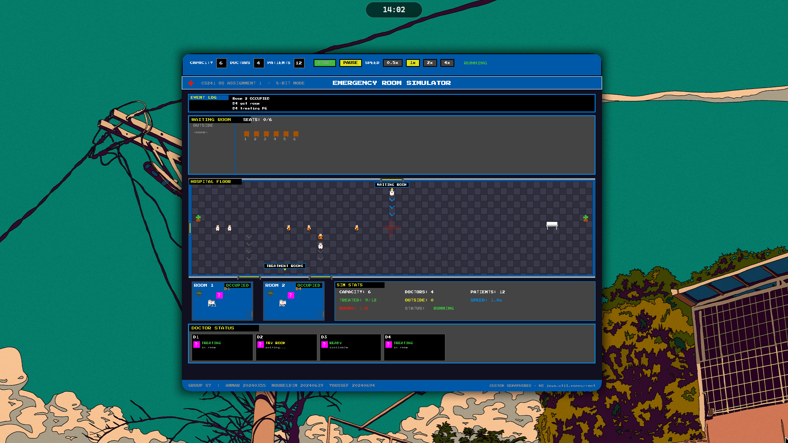

# 🏥 Hospital Emergency Room Simulation

CS241 Operating Systems, Assignment 1, Fall 2026

TA: Andro | Group: S7

| #   | Name          | ID       |
| --- | ------------- | -------- |
| 1   | Ammar Ayman   | 20240355 |
| 2   | NourEldin     | 20240639 |
| 3   | Youssef Saleh | 20240694 |

---
## Screenshots

|              Title Screen               |             Full Floor View              |
| :-------------------------------------: | :--------------------------------------: |
|   |      |
|           **Treatment Rooms**           |             **Waiting Room**             |
|  |  |

---

Welcome to the most chaotic (yet perfectly synchronized) emergency room in Java! 🚑 

Patients are showing up, fighting for limited seats in the waiting room, and doctors are scooping them up one by one. The catch? We only have *two* treatment beds. If the doctors can't secure a room in time, they have to awkwardly send the patient back to the waiting line. 

**The Flex:** All the underlying thread coordination is powered by a `Semaphore` class we built completely from scratch—no `java.util.concurrent` easy-mode here! 🧠💻

> 🤓 **Nerd Alert:** Want to see the deep technical details on backend concurrency, threading logic, and how we dodge deadlocks? Check out [ARCHITECTURE.md](ARCHITECTURE.md).

---

## 🎮 Download & Play

You don't need to compile any code to play! We did the hard work for you.

1. Head over to the **Releases** section on the right side of this GitHub repository.
2. Download the latest `.jar` file.
3. Double-click that `.jar` and watch the chaos unfold.

*(Hardcore terminal users: `java -jar Hospital.jar` works too).*

---

### 🏙️ Isometric Game Mode (Default)

This launches our glorious 8-bit isometric 2.5D hospital game. You'll start at an in-canvas title screen to set the stakes (up to 99 patients and 12 doctors!). Once inside, you get a shared isometric world with three camera views:

- `[WAITING]` — Watch the queue build up.
- `[TREATMENT]` — Two beds, complete with IV drips and tiny heart monitors. ❤️📈
- `[FULL FLOOR]` — The bird's-eye view of the madness.

You'll also get a top HUD tracking live stats, an animated glass entrance door, and ID tags floating over everyone's heads.

**Director Controls 🎬:**
- **Drag:** Pan around the hospital
- **Mouse wheel:** Zoom in and out
- **Tab / 1-3:** Switch camera views
- **Space:** Pauses the visuals (but the backend simulation keeps running in the shadows 👀)
- **T:** Toggles the one-line event strip
- **R:** Resets the camera
- **Enter:** Returns to the title screen (only works on the completion overlay!)

Two display settings are selectable on the title screen (look for the chips at the bottom) or via these hotkeys during the simulation:

| Setting | Choices | Keys |
|---|---|---|
| **FONT** | `PIXEL` (Press Start 2P) or `READABLE` (plain monospaced) | `F` |
| **PACING** | `OFF` (instant), `DELAY` (events spaced out), `STEP` (step-by-step) | `V`, then `N` to step |
| **DELAY** | 0.3s / 0.7s / 1.2s / 2.0s between events in `DELAY` mode | `D` |

*Note: `DELAY` and `STEP` are purely visual. The backend simulation is completely untouched and keeps chugging along underneath. Pausing just freezes the playback clock, and completion only triggers once the visual queue has finally drained.* ⏳

---

### 📟 Legacy 8-bit GUI Mode



Feeling nostalgic? If you prefer to watch the original 2D dashboard-style GUI, you can launch the game via your terminal using the legacy flag:

```bash
java -jar Hospital.jar --legacy